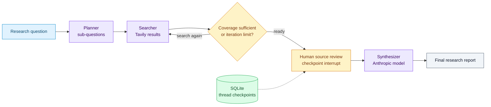
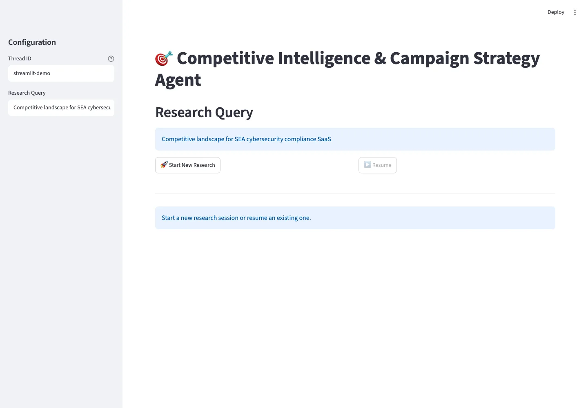
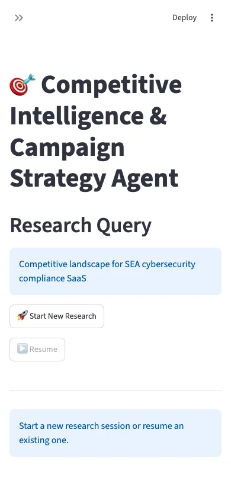

# LangGraph Competitive Intelligence & Campaign Strategy Agent

This project implements a **Competitive Intelligence & Campaign Strategy Agent** for marketing use cases using **LangGraph** and **LangChain**. It goes beyond a generic chatbot by using **iterative research loops**, **persistent state**, and **conditional routing** to build higher‑quality strategic outputs.

## The research loop and approval checkpoint

The evaluator can request another search while the iteration count is below four. SQLite checkpoints retain the thread state, and the graph always interrupts before synthesis.



The included UI runs with `streamlit run demo/app.py`. Configure `TAVILY_API_KEY` and `ANTHROPIC_API_KEY` privately. Resume with `graph.invoke(None, config)` using the original `thread_id`; the UI exposes that action after source review.

## What Makes This Different

- **Persistent State**: Accumulates results across search iterations for richer synthesis.
- **Iterative Refinement**: Loops until coverage is strong (or a guardrail is reached).
- **Conditional Routing**: Evaluation node decides whether to continue searching.
- **Human‑in‑the‑Loop (HITL)**: Optional approval before final synthesis.

## Architecture Overview

```
Query
  │
  ▼
Planner → Searcher → Evaluator ─┐
  ▲                            │
  └──────────── loop ──────────┘
              │
              ▼
         Synthesizer → Final Report
```

## Quick Start

1. **Install dependencies**
    ```bash
    pip install -r requirements.txt
    # or install the package in editable mode
    pip install -e .
    ```

2. **Configure environment**
   ```bash
   cp .env.example .env
   ```
   Fill in required keys.

3. **Run example**
   ```bash
   python examples/marketing_usecase.py
   ```

> The example pauses before synthesis. Review the checkpoint, then resume with `graph.invoke(None, config)` and the same `thread_id`.

## Repo Layout

```
codebase/
├── README.md
├── pyproject.toml
├── requirements.txt
├── .env.example
├── src/
│   └── research_agent/
│       ├── __init__.py
│       ├── application/
│       │   ├── graph.py
│       │   └── nodes/
│       │       ├── planner.py
│       │       ├── searcher.py
│       │       ├── evaluator.py
│       │       ├── synthesizer.py
│       │       └── hitl.py
│       ├── domain/
│       │   ├── prompts.py
│       │   └── state.py
│       └── infrastructure/
│           └── clients.py
├── examples/
│   └── marketing_usecase.py
├── demo/
│   └── app.py
├── docs/
│   └── ARCHITECTURE.md
└── tests/
    └── test_graph.py
```

The `src/research_agent` package separates orchestration (`application`), business state and prompts (`domain`), and external adapters (`infrastructure`) while preserving the existing LangGraph workflow and CLI/demo entrypoints.

## Roadmap Alignment

This repository implements **Phase 0–3** of the technical roadmap:

- **Phase 0**: Repo scaffolding
- **Phase 1**: State definition
- **Phase 2**: Node implementations
- **Phase 3**: Graph assembly

A Streamlit interface is already included in `demo/app.py`. Provider-backed research requires local credentials; the presence of the UI does not establish research quality.

## Captures

Running Streamlit interface. Provider-backed research not invoked.





Full capture descriptions and provenance: [captures.json](docs/screenshots/captures.json).
